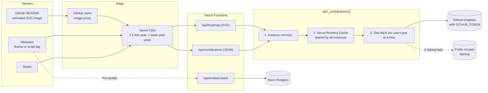
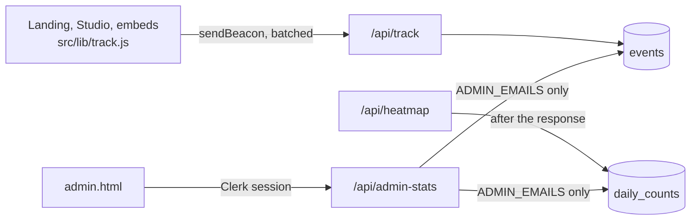

# Architecture

How a heatmap gets from GitHub to a README, a website or the Studio, and why lots of traffic doesn't use up our GitHub quota.

**In one line:** however many places show the same person's year, their contributions are fetched from GitHub at most once an hour (once a week for past years). Everything else is answered from a cache.

## Request flow



| Layer | What it keeps | How long |
|---|---|---|
| GitHub camo + Vercel CDN | The finished response for one exact URL | 1 hour (this year), 1 week (past years), then served stale while it refreshes |
| Instance memory | The data for one user+year (up to 500 entries per instance) | Same as above |
| Vercel Runtime Cache | Same data, shared by every instance in the region | Kept a week, so it can stand in when GitHub is down |
| Request sharing | One fetch in progress per user+year | 1,000 simultaneous requests make 1 call |

Themes, angles and animations each have their own URL (so the CDN caches each picture), but they all share one copy of the data. Only the drawing is repeated, and that takes milliseconds.

## Data sources

1. **GitHub GraphQL API**, when `GITHUB_TOKEN` is set. Any token, no scopes. 5,000 points an hour, and a contribution lookup costs about one.
2. **github-contributions-api.jogruber.de**, a public scraper of the profile calendar. Used when there's no token, and as a backup when GitHub fails.

Every result is padded to the full year (Jan 1 to Dec 31), so both sources look the same to the renderers.

## When something goes wrong

| What happens | What the code does |
|---|---|
| A README goes viral | The CDN and GitHub's proxy answer it. The function renders that URL about once an hour. |
| 1,000 people open a new user at once | One GitHub fetch. The other 999 requests wait for it and share the result. |
| GitHub is down or rate limits us | Falls back to the scraper. If both fail, the last copy (up to a week old) is served with a 5-minute cache, so it refreshes soon. |
| Thousands of random usernames | Names that can't be GitHub usernames are rejected without a lookup. Unknown users are remembered for an hour. Each IP gets 30 uncached lookups a minute per instance (cached ones are unlimited). |
| A large, spread-out attack | The per-IP limit is per instance, not global. Add a **Vercel Firewall rate-limit rule** on `/api/*` for a hard limit. |
| Quota runs short at very high scale | Past years cost nothing after the first fetch. Past ~5,000 distinct users an hour, extra lookups use the scraper or get the last copy. Next steps: a second token, or refresh this year every 3 hours. |
| Database is slow or down | Only Pro embeds ask it (`/api/embed-check`, cached 5 minutes per key). If it fails, the embed shows the free City instead of breaking. |

## Capacity, roughly

For `U` people whose heatmap gets viewed each day, `V` views per person per day and `N` different image URLs per person:

- **Views:** `U × V`
- **Reach our functions:** at most `U × N × min(24, V)`, since each URL is rendered at most once an hour
- **Reach GitHub:** at most `U × min(24, V)` a day, so about `U × min(24, V) / 24 × 2` in the busiest hour (assuming the busiest hour carries twice the average)

Examples, with 2 URLs per person and views spread through the day:

| People viewed per day | Views each | Views a day | Renders a day | GitHub lookups, busiest hour | Share of one token |
|---|---|---|---|---|---|
| 1,000 | 100 | 100,000 | 48,000 | ~2,000 | 40% |
| 2,000 | 100 | 200,000 | 96,000 | ~4,000 | 80% |
| 10,000 | 100 | 1,000,000 | 480,000 | ~20,000 | 400% |

Past about 2,500 people being viewed every hour, one token isn't enough on its own. Images keep loading (extra lookups use the scraper, or get the last copy), but before that point add a second token or refresh this year every 3 hours, which divides lookups by 3. People with few views cost much less: someone viewed 5 times a day costs at most 5 lookups.

## The animated README image

GitHub READMEs only show images and never run scripts, so the animation is written into the SVG itself (SMIL `<animateTransform>`). It plays inside any ``: GitHub, GitLab, Notion, docs sites. Renderers without SMIL show the finished board.

- `animate=grow`: bars rise in a wave from January to December, then a soft light sweeps across them every few seconds.
- `animate=loop`: rise, hold, fall, repeat.

How it works (`src/lib/svg.js`): each bar with contributions starts sunk into the board and slides up. It's clipped to its own full-height outline, so the part still "underground" is hidden and the bar looks like it's growing. One small animation per bar keeps the file small: about 205 KB for a year where every day is active, about 90 KB for the still image, and much less after gzip. The light sweep is one gradient band masked by the bars.

## Analytics



- Pages queue events and send them in batches of up to 20 (or every 4 seconds, or when the tab is hidden) with `sendBeacon`, so tracking never slows a page down.
- `/api/track` drops bots, keeps only the referrer's host, adds country (from Vercel's edge) and device, and replaces the IP with a daily visitor hash. It accepts 30 events per request and 120 per IP per minute.
- README image renders are counted per user, picture and animation in `daily_counts` (one upsert per render, after the response is sent).
- The admin numbers are a handful of SQL queries over `events`, run in parallel. At very high volume, add a daily rollup table or move events to a dedicated analytics store; the indexes on `at` and `(name, at)` cover the current queries.

## Testing

```bash
npm test                                                                  # unit tests: animation output, caching, request sharing, rate limits
npm run load-test -- http://localhost:5173 --requests 400 --concurrency 40
npm run load-test -- https://YOUR-SITE --requests 1000 --concurrency 100  # only sites you own
```

The load test reports latency, status codes, where the data came from (`X-Data-Source`: `memory`, `shared`, `upstream`, `joined`, `stale`) and CDN hits (`x-vercel-cache`). Only `upstream` requests reached GitHub. Locally there's no CDN, so latency is the worst case.

Measured on the dev server: 400 requests across 4 users made 1 GitHub call (3 users were already cached).

## Before launch

- [ ] Set `GITHUB_TOKEN` in Vercel.
- [ ] Add a Vercel Firewall rate-limit rule on `/api/*`.
- [ ] Run the load test against a preview deployment, then production.
- [ ] Check the animated image in a real README, on desktop and in the GitHub mobile app.
